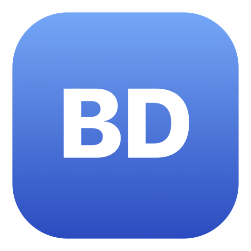
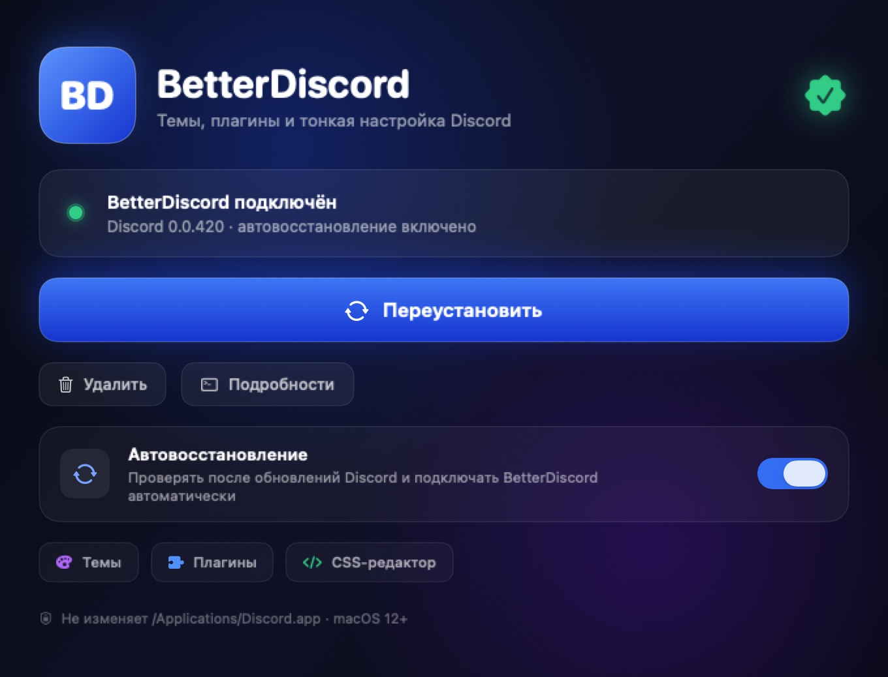
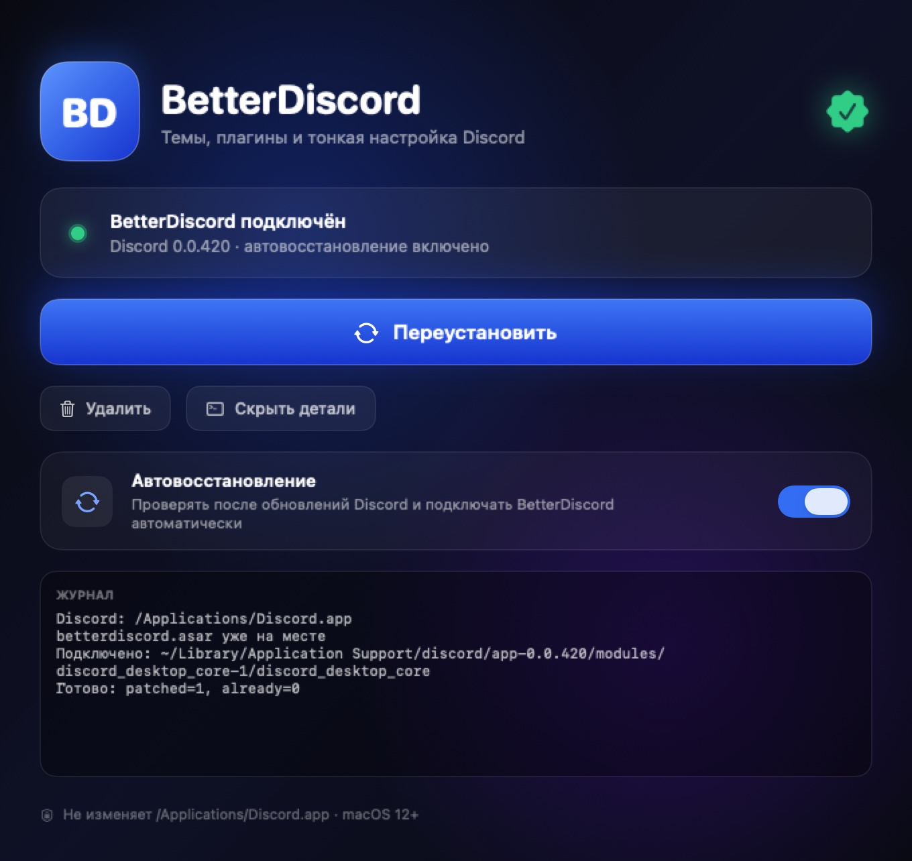

<div align="center">



# BetterDiscord Installer for macOS

**A native, animated installer and self-healing auto-repair agent for [BetterDiscord](https://betterdiscord.app) on macOS.**

[](https://www.apple.com/macos/)
[](#compatibility)
[](LICENSE)
[](https://developer.apple.com/swiftui/)

[Русская версия](README.ru.md) · [Download](../../releases/latest) · [How it works](#how-it-works) · [Troubleshooting](#troubleshooting)

</div>



## Why this exists

The official BetterDiscord installer v2.0.0 currently has two macOS problems:

- it crashes at launch on **Apple M5** because of a `go-m1cpu` bug ([Installer #434](https://github.com/BetterDiscord/Installer/issues/434));
- on macOS 26 it cannot reliably write into `/Applications/Discord.app` because of App Management, and its bundle is not properly signed ([Installer #424](https://github.com/BetterDiscord/Installer/issues/424)).

This project installs BetterDiscord **without touching the Discord application bundle at all**. It uses Discord's per-user core module, the same technique the v1.x installer used, and adds automatic repair after Discord updates.

## Features

- 🎨 **Native SwiftUI UI** — animated gradients, glow, hover/press effects, smooth window resizing and success animations.
- ⚡ **One-click install / reinstall / remove** — no Terminal, no `sudo`, no admin password.
- 🛡 **Self-healing** — a small LaunchAgent checks every 2 minutes and re-applies the injection after a Discord update. You install once and forget it.
- 🧩 **Stable, PTB and Canary** — all installed Discord channels are detected and patched.
- 💾 **Keeps your data** — plugins, themes and settings stay in `~/Library/Application Support/BetterDiscord`.
- 🧬 **Universal binary** — Apple Silicon and Intel, macOS 12 Monterey or newer.
- 🔓 **Open source** — MIT licensed, no telemetry, no bundled third-party code.

## Install

1. Download **`BetterDiscord-Mac-Installer-1.0.0.dmg`** from the [latest release](../../releases/latest).
2. Open the DMG and drag **BetterDiscord Installer** to **Applications**.
3. **First launch:** right-click the app → **Open** → **Open**.
   The app is ad-hoc signed but not notarized (there is no Apple Developer ID behind this project), so macOS asks for confirmation once.
4. Click **Install BetterDiscord**. Discord will restart automatically.
5. Done. Open Discord → **User Settings (⌘,)** → **BetterDiscord**.

> **No admin rights required.** The installer never modifies `/Applications/Discord.app`; it only writes to your user Library.

## Usage

| Action | What it does |
| --- | --- |
| **Install / Reinstall** | Closes Discord, downloads the latest official `betterdiscord.asar`, patches the active core module and restarts Discord. |
| **Remove** | Restores the original `index.js`, disables auto-repair and restarts Discord. Your plugins and themes are kept. |
| **Auto-repair** | When enabled, a LaunchAgent re-applies the patch after Discord updates — even if this app is closed or deleted. |



## How it works

Instead of modifying `Discord.app`, the installer patches the per-user module that Discord loads at startup:

```text
~/Library/Application Support/discord/app-<version>/modules/
└── discord_desktop_core-1/discord_desktop_core/index.js
```

The original file is saved next to it as `index.js.orig`, and `index.js` becomes:

```js
require("/Users/<you>/Library/Application Support/BetterDiscord/data/betterdiscord.asar");
module.exports = require("./core.asar");
```

`betterdiscord.asar` is downloaded from the official [BetterDiscord releases](https://github.com/BetterDiscord/BetterDiscord/releases) — it is **not** bundled with this project.

Auto-repair files:

```text
~/Library/Application Support/BetterDiscord/auto-repair.sh
~/Library/LaunchAgents/app.betterdiscord.installer.autorepair.plist
~/Library/Application Support/BetterDiscord/auto-repair.log
```

## Compatibility

| | |
| --- | --- |
| macOS | 12 Monterey or newer |
| CPU | Apple Silicon + Intel (universal) |
| Discord | Stable, PTB, Canary |
| Installer version | 1.0.0 |

Discord must be installed in `/Applications` or `~/Applications`.

## Troubleshooting

**“Discord ещё не запускался” / “Discord has not been launched yet”**
Launch Discord once, quit it, then open the installer again. Discord creates the core module on its first run.

**macOS refuses to open the app**
Right-click → **Open** → **Open**. Alternatively:

```sh
xattr -dr com.apple.quarantine "/Applications/BetterDiscord Installer.app"
```

**BetterDiscord is not visible in Discord settings**
Make sure the install finished without errors, then fully quit Discord (⌘Q) and open it again. Check the log in the app under **Details**.

**After a Discord update**
Auto-repair handles it within a couple of minutes and restarts Discord. If auto-repair is disabled, just press **Install** again.

**Auto-repair log**

```sh
tail -50 "$HOME/Library/Application Support/BetterDiscord/auto-repair.log"
```

**Uninstall**
Press **Remove** in the app. To remove everything manually:

```sh
launchctl bootout "gui/$(id -u)/app.betterdiscord.installer.autorepair" 2>/dev/null
rm -f "$HOME/Library/LaunchAgents/app.betterdiscord.installer.autorepair.plist"
rm -rf "$HOME/Library/Application Support/BetterDiscord"
```

## Build from source

Requirements: macOS 12+, Xcode Command Line Tools.

```sh
git clone <this-repo>
cd BetterDiscordInstaller

./build.sh              # universal app + icon
./build-dmg.sh 1.0.0    # styled DMG in dist/
```

Outputs:

```text
dist/BetterDiscord Installer.app
dist/BetterDiscord-Mac-Installer-1.0.0.dmg
```

The app is ad-hoc signed (`codesign --force --deep --sign -`). Without a Developer ID certificate it cannot be notarized, so first launch requires right-click → Open.

## Credits

This project would not exist without the work of the BetterDiscord team:

- **[BetterDiscord](https://github.com/BetterDiscord/BetterDiscord)** — Apache-2.0, © BetterDiscord Team. Created by [Zerebos](https://github.com/zerebos) and contributors.
- **[BetterDiscord Installer](https://github.com/BetterDiscord/Installer)** — MIT, © BetterDiscord Team. The injection approach and download endpoints are based on the v1.x installer by [Zerebos](https://github.com/zerebos) and contributors.
- The community workaround for macOS App Management from [Installer #424](https://github.com/BetterDiscord/Installer/issues/424).
- [Discord](https://discord.com) is a trademark of Discord Inc.

See [NOTICE.md](NOTICE.md) for full third-party notices.

## Disclaimer

This is an **unofficial** community project. It is not affiliated with, endorsed by, or supported by Discord Inc. or the BetterDiscord team. Using BetterDiscord modifies the Discord client and may violate Discord's Terms of Service — use at your own risk.

## License

[MIT](LICENSE) © BetterDiscord Mac Installer contributors.
