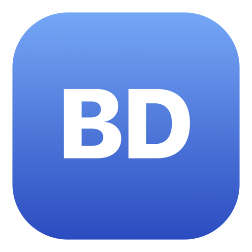
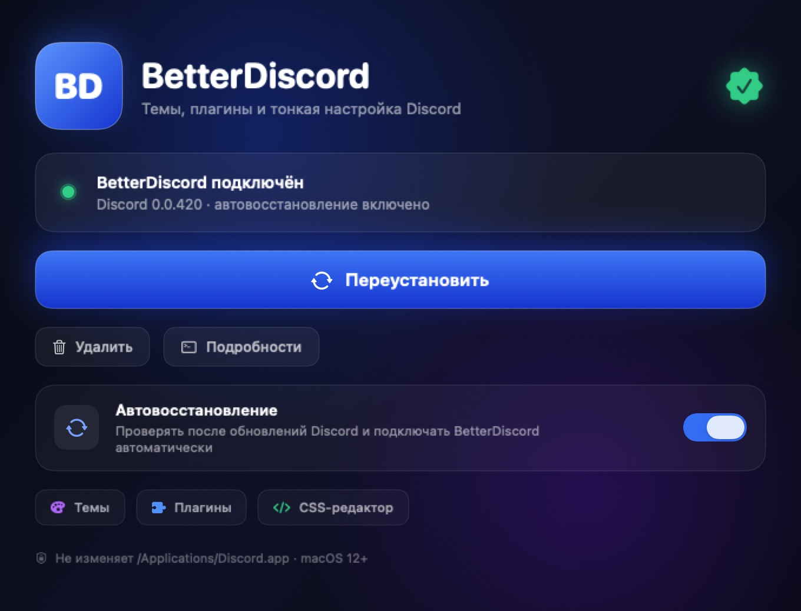
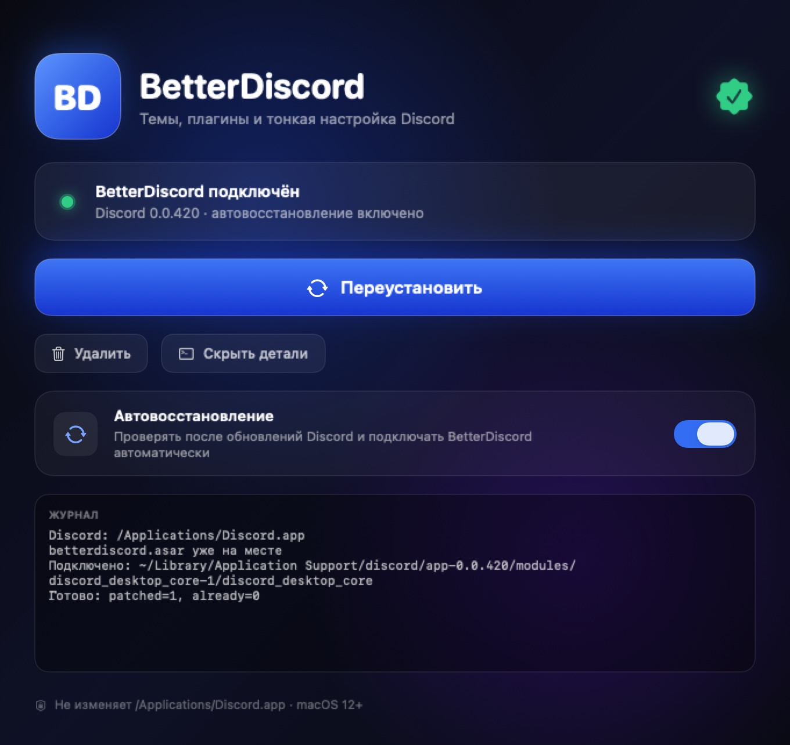

<div align="center">



# BetterDiscord Installer для macOS

**Нативный установщик BetterDiscord с анимациями и автовосстановлением после обновлений Discord.**

[](https://www.apple.com/macos/)
[](#совместимость)
[](LICENSE)
[](https://github.com/R3G1ST/betterdiscord-mac-installer/releases/latest)

[English version](README.md) · [Скачать](https://github.com/R3G1ST/betterdiscord-mac-installer/releases/latest) · [Как это работает](#как-это-работает) · [Решение проблем](#решение-проблем)

</div>



## Зачем это нужно

У официального установщика BetterDiscord v2.0.0 есть две проблемы на macOS:

- он падает при запуске на **Apple M5** из-за бага в `go-m1cpu` ([Installer #434](https://github.com/BetterDiscord/Installer/issues/434));
- на macOS 26 он не может стабильно писать в `/Applications/Discord.app` из-за App Management, а его bundle подписан неправильно ([Installer #424](https://github.com/BetterDiscord/Installer/issues/424)).

Этот установщик **вообще не трогает `Discord.app`**. Он подключает BetterDiscord через пользовательский core-модуль Discord — тот же способ, который использовал установщик v1.x, — и автоматически восстанавливает инъекцию после обновлений.

## Возможности

- 🎨 **Нативный интерфейс на SwiftUI** — анимированные градиенты, свечение, hover/press-эффекты, плавное изменение размера окна.
- ⚡ **Установка / переустановка / удаление в один клик** — без Terminal, `sudo` и пароля администратора.
- 🛡 **Автовосстановление** — LaunchAgent раз в 2 минуты проверяет Discord и повторяет инъекцию после обновления. Один раз установил — дальше можно забыть.
- 🧩 **Stable, PTB и Canary** — находятся и патчатся все установленные каналы.
- 💾 **Данные сохраняются** — плагины, темы и настройки остаются в `~/Library/Application Support/BetterDiscord`.
- 🧬 **Universal** — Apple Silicon и Intel, macOS 12 Monterey и новее.
- 🔓 **Открытый код** — MIT, без телеметрии и без встроенного стороннего кода.

## Установка

### Вариант A — одна команда (рекомендую для macOS 26 Tahoe)

macOS 26 блокирует DMG без нотаризации, скачанные через браузер, и правый клик →
**Открыть** больше не помогает. Эта команда скачивает DMG через `curl` (без флага
quarantine), ставит приложение в `/Applications` и запускает его:

```sh
curl -fsSL https://raw.githubusercontent.com/R3G1ST/betterdiscord-mac-installer/main/install.sh | bash
```

### Вариант B — DMG

1. Скачай **`BetterDiscord-Mac-Installer-1.0.0.dmg`** из [последнего релиза](https://github.com/R3G1ST/betterdiscord-mac-installer/releases/latest).
2. Если macOS пишет **«Apple не удалось подтвердить…»** или **«повреждён»** — нажми **«Готово»** и выполни:
   ```sh
   xattr -d com.apple.quarantine ~/Downloads/BetterDiscord-Mac-Installer-1.0.0.dmg
   open ~/Downloads/BetterDiscord-Mac-Installer-1.0.0.dmg
   ```
3. Перетащи **BetterDiscord Installer** в **Applications**.
4. Сними quarantine с установленного приложения и открой его:
   ```sh
   xattr -dr com.apple.quarantine "/Applications/BetterDiscord Installer.app"
   open "/Applications/BetterDiscord Installer.app"
   ```
5. Нажми **«Установить BetterDiscord»**. Discord перезапустится автоматически.
6. Открой Discord → **Настройки пользователя (⌘,)** → **BetterDiscord**.

> **Почему так?** Приложение подписано ad-hoc, но не нотаризовано — для
> нотаризации нужен платный Apple Developer ID. macOS 26 считает такие
> приложения недоверенными, поэтому флаг quarantine нужно снять один раз вручную.
> На macOS 15 и раньше достаточно правого клика → **Открыть**.
>
> **Права администратора не нужны.** Установщик не меняет
> `/Applications/Discord.app`, а пишет только в твою пользовательскую Library.

## Использование

| Кнопка | Что делает |
| --- | --- |
| **Установить / Переустановить** | Закрывает Discord, скачивает актуальный официальный `betterdiscord.asar`, патчит активный core-модуль и перезапускает Discord. |
| **Удалить** | Возвращает оригинальный `index.js`, выключает автовосстановление и перезапускает Discord. Плагины и темы сохраняются. |
| **Автовосстановление** | LaunchAgent повторяет патч после обновлений Discord — даже если приложение закрыто или удалено. |



## Как это работает

Вместо изменения `Discord.app` установщик патчит пользовательский модуль, который Discord загружает при старте:

```text
~/Library/Application Support/discord/app-<версия>/modules/
└── discord_desktop_core-1/discord_desktop_core/index.js
```

Оригинал сохраняется рядом как `index.js.orig`, а `index.js` становится таким:

```js
require("/Users/<ты>/Library/Application Support/BetterDiscord/data/betterdiscord.asar");
module.exports = require("./core.asar");
```

`betterdiscord.asar` скачивается из официальных [релизов BetterDiscord](https://github.com/BetterDiscord/BetterDiscord/releases) — он **не** входит в этот проект.

Файлы автовосстановления:

```text
~/Library/Application Support/BetterDiscord/auto-repair.sh
~/Library/LaunchAgents/app.betterdiscord.installer.autorepair.plist
~/Library/Application Support/BetterDiscord/auto-repair.log
```

## Совместимость

| | |
| --- | --- |
| macOS | 12 Monterey или новее |
| Процессор | Apple Silicon + Intel (universal) |
| Discord | Stable, PTB, Canary |
| Версия установщика | 1.0.0 |

Discord должен быть установлен в `/Applications` или `~/Applications`.

## Решение проблем

**«Discord ещё не запускался»**
Запусти Discord один раз, закрой его и открой установщик снова. Core-модуль создаётся при первом запуске Discord.

**macOS не даёт открыть приложение**
Правый клик → **Открыть** → **Открыть**. Либо:

```sh
xattr -dr com.apple.quarantine "/Applications/BetterDiscord Installer.app"
```

**В настройках Discord нет BetterDiscord**
Убедись, что установка завершилась без ошибок, полностью закрой Discord (⌘Q) и открой снова. Лог смотри в приложении по кнопке **«Подробности»**.

**После обновления Discord**
Автовосстановление сработает в течение пары минут и перезапустит Discord. Если оно выключено — просто нажми **«Установить»** ещё раз.

**Лог автовосстановления**

```sh
tail -50 "$HOME/Library/Application Support/BetterDiscord/auto-repair.log"
```

**Удаление**
Нажми **«Удалить»** в приложении. Полностью вручную:

```sh
launchctl bootout "gui/$(id -u)/app.betterdiscord.installer.autorepair" 2>/dev/null
rm -f "$HOME/Library/LaunchAgents/app.betterdiscord.installer.autorepair.plist"
rm -rf "$HOME/Library/Application Support/BetterDiscord"
```

## Сборка из исходников

Нужны macOS 12+ и Xcode Command Line Tools.

```sh
git clone https://github.com/R3G1ST/betterdiscord-mac-installer.git
cd BetterDiscordInstaller

./build.sh              # universal-приложение + иконка
./build-dmg.sh 1.0.0    # оформленный DMG в dist/
```

Результат:

```text
dist/BetterDiscord Installer.app
dist/BetterDiscord-Mac-Installer-1.0.0.dmg
```

Приложение подписано ad-hoc. Без сертификата Developer ID его нельзя нотаризовать, поэтому при первом запуске нужно правый клик → «Открыть».

## Благодарности

Проект был бы невозможен без команды BetterDiscord:

- **[BetterDiscord](https://github.com/BetterDiscord/BetterDiscord)** — Apache-2.0, © BetterDiscord Team. Автор — [Zerebos](https://github.com/zerebos) и контрибьюторы.
- **[BetterDiscord Installer](https://github.com/BetterDiscord/Installer)** — MIT, © BetterDiscord Team. Способ инъекции и эндпоинты загрузки основаны на установщике v1.x ([Zerebos](https://github.com/zerebos) и контрибьюторы).
- Обходной путь для App Management из [Installer #424](https://github.com/BetterDiscord/Installer/issues/424).
- [Discord](https://discord.com) — торговая марка Discord Inc.

Полные уведомления: [NOTICE.md](NOTICE.md).

## Дисклеймер

Это **неофициальный** проект. Он не связан с Discord Inc. и командой BetterDiscord и не поддерживается ими. BetterDiscord изменяет клиент Discord и может нарушать Terms of Service Discord — используй на свой риск.

## Лицензия

[MIT](LICENSE) © BetterDiscord Mac Installer contributors.
